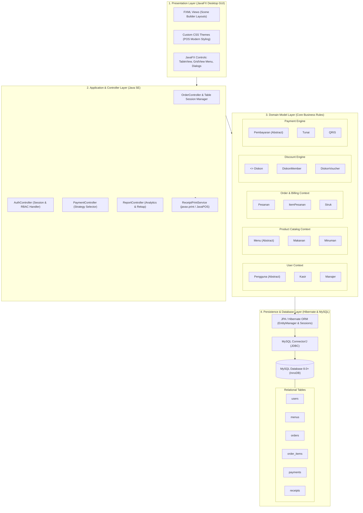
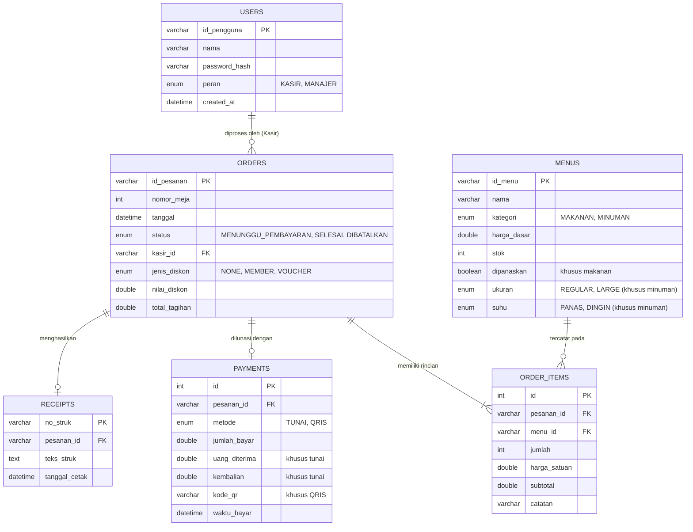

# Dokumentasi Arsitektur & Stack Teknologi: Sistem Pemesanan & Pembayaran Restoran

Dokumen ini menguraikan arsitektur sistem tingkat tinggi (*high-level architecture*), spesifikasi tumpukan teknologi (*technology stack*) berbasis **Full Stack Java Desktop**, pembagian lapisan (*layering*), integrasi komponen, kepatuhan terhadap prinsip desain perangkat lunak (*SOLID principles* & *GoF patterns*), pemodelan basis data relasional MySQL, serta strategi pencetakan struk dan distribusi aplikasi.

---

## 1. Arsitektur Berlapis (Layered Architecture - Full Stack Java Desktop)

Sistem dirancang menggunakan arsitektur modular berlapis (*Layered Architecture 4-Tier*) berbasis **Java Desktop Application (MVC / MVP Pattern)**, memisahkan antarmuka grafis (GUI), pengendali alur (*controllers/services*), aturan logika bisnis domain (*pure OOP*), dan persistensi data permanen:

### Deskripsi Lapisan Sistem:
1. **Presentation Layer (Lapisan Antarmuka GUI - JavaFX)**:
   - Antarmuka grafis desktop modern berbasis **JavaFX** dengan pemisahan tata letak via **FXML** dan styling menggunakan **CSS**.
   - Menyediakan tampilan visual responsif untuk kasir: grid katalog menu makanan/minuman, keranjang pesanan meja interaktif, dialog kalkulasi pembayaran kembalian, dan modal input diskon.
2. **Application & Controller Layer (Lapisan Pengendali & Layanan)**:
   - Berisi kelas-kelas Controller JavaFX yang menangani interaksi pengguna (*event handling*), otentikasi login, validasi sesi peran (*RBAC*), serta koordinasi alur transaksi.
   - Mengintegrasikan layanan pencetakan fisik (*ReceiptPrintService*) menggunakan pustaka `javax.print` / JavaPOS untuk mencetak langsung ke printer struk thermal USB/LAN.
3. **Domain Layer (Lapisan Logika Bisnis OOP Murni)**:
   - Mengimplementasikan seluruh model kelas: `Pengguna`, `Manajer`, `Kasir`, `Menu`, `Makanan`, `Minuman`, `ItemPesanan`, `Pesanan`, `Diskon`, `Pembayaran`, dan `Struk`.
   - Menjamin bahwa aturan bisnis (perhitungan harga menu berdasarkan varian suhu/pemanasan, pemotongan stok otomatis, limitasi diskon, kembalian tunai, verifikasi QRIS) terisolasi penuh tanpa ketergantungan pada komponen GUI.
4. **Persistence Layer (Lapisan Penyimpanan Data - Hibernate & MySQL)**:
   - Menggunakan **Hibernate ORM / Jakarta Persistence (JPA)** untuk memetakan objek kelas domain langsung ke tabel basis data relasional.
   - Terhubung ke basis data **MySQL 8.0+ (InnoDB)** menggunakan driver **MySQL Connector/J** dengan jaminan transaksi ACID (*Atomicity, Consistency, Isolation, Durability*).

---

## 2. Spesifikasi Stack Teknologi (Technology Stack)

### 2.1. Ringkasan Eksekutif Stack Teknologi

| Komponen / Lapisan | Teknologi Terpilih | Detail & Peran dalam Sistem |
| :--- | :--- | :--- |
| **Platform & Bahasa** | **Java SE 17+ LTS / 21+ LTS** | Platform inti dengan typing kuat, modern pattern matching, records, & OOP murni |
| **Desktop GUI Toolkit** | **JavaFX 21+ (OpenJFX)** | Antarmuka grafis desktop modern, FXML declaratif, CSS styling, & Scene Builder |
| **ORM / Data Access** | **Hibernate 6.x / Jakarta Persistence (JPA)** | Object-Relational Mapping dengan dukungan *Polymorphic Table Inheritance* |
| **Database Server** | **MySQL 8.0+ (InnoDB Engine)** | Penyimpanan data relasional permanen, ACID transactions, & foreign key integrity |
| **Database Connector** | **MySQL Connector/J 8.x** | Driver JDBC standar industri untuk komunikasi antara Java dan MySQL Server |
| **Hardware & Printing** | **Java Print Service (`javax.print`) / JavaPOS** | Integrasi cetak struk thermal POS (ESC/POS) dan trigger laci uang (*cash drawer*) |
| **Pola Arsitektur** | **Layered MVC / MVP** | Pemisahan Presentation (JavaFX), Controller/Service, Domain Model, & Persistence |
| **Prinsip Desain** | **SOLID Principles** | SRP, OCP, LSP, ISP, dan DIP untuk keterperawatan dan skalabilitas kode |
| **Design Patterns (GoF)**| **Strategy & Template Method** | Polimorfisme strategi diskon/pembayaran & kalkulasi hierarki menu |
| **Build & Dependency Tool** | **Apache Maven / Gradle** | Manajemen pustaka dependensi (JavaFX, Hibernate, MySQL, JUnit) secara terotomatisasi |
| **Packaging & Distribusi** | **`jpackage` (Java Native Packager)** | Mengemas aplikasi menjadi file **`.exe` (Windows Installer / Standalone)** lengkap dengan runtime JVM |
| **Testing & QA** | **JUnit 5 (Jupiter) & TestFX** | Unit testing logika bisnis domain dan automated testing antarmuka JavaFX |
| **Dokumentasi & Pemodelan** | **Mermaid.js & Markdown (GFM)** | Visualisasi diagram arsitektur, ERD relasional, flowchart, dan sequence diagram |

### 2.2. Manajemen Dependensi Utama (Maven `pom.xml`)

Untuk membangun sistem ini, proyek menggunakan dependensi standar Java berikut:
- `org.openjfx:javafx-controls` & `javafx-fxml`: Antarmuka grafis desktop dan pengendali FXML.
- `org.hibernate.orm:hibernate-core`: Engine ORM untuk pemetaan entitas domain.
- `com.mysql:mysql-connector-j`: Driver konektivitas JDBC ke MySQL.
- `org.junit.jupiter:junit-jupiter`: Framework pengujian unit logika bisnis.
- `org.testfx:testfx-junit5`: Framework pengujian otomatis antarmuka pengguna JavaFX.

---

## 3. Desain Basis Data Relasional (MySQL Schema)

Basis data MySQL dirancang untuk mendukung integritas transaksi restoran:

---

## 4. Pola Desain & Rekayasa Perangkat Lunak (Design Patterns & SOLID)

### 4.1. Gang of Four (GoF) Design Patterns dalam Java
1. **Strategy Pattern (Diskon & Pembayaran)**:
   - **Diskon**: `interface Diskon` dengan implementasi konkret `class DiskonMember implements Diskon` (strategi persentase) dan `class DiskonVoucher implements Diskon` (strategi nominal flat). Kelas `Pesanan` dapat bertukar algoritma diskon secara dinamis saat runtime (*polymorphism*).
   - **Pembayaran**: `abstract class Pembayaran` dengan implementasi konkret `class Tunai extends Pembayaran` (kalkulasi kembalian) dan `class QRIS extends Pembayaran` (validasi QR code digital).
2. **Template Method Pattern (Penetapan Harga Menu)**:
   - `abstract class Menu` mendefinisikan kerangka perhitungan `hitungHarga()`, yang di-*override* secara spesifik oleh `class Makanan extends Menu` (biaya pemanasan) dan `class Minuman extends Menu` (penyesuaian ukuran *large* dan varian suhu).
3. **Composite & Aggregation**:
   - `Pesanan` mengontrol penuh kepemilikan siklus hidup `ItemPesanan` dan `Struk` (komposisi), serta mengasosiasikan `Kasir`, `Diskon`, dan `Pembayaran` (agregasi) secara *loose coupling*.

### 4.2. Penerapan Prinsip SOLID
- **Single Responsibility Principle (SRP)**: Kelas Controller JavaFX hanya menangani input GUI, kelas domain hanya mengurus aturan bisnis restoran, dan kelas DAO/Repository JPA hanya mengurus persistensi ke MySQL.
- **Open/Closed Principle (OCP)**: Menambah opsi metode pembayaran baru (misal *Debit Card* atau *Voucher Elektronik*) cukup dengan membuat kelas turunan baru tanpa merombak kode `Pesanan`.
- **Liskov Substitution Principle (LSP)**: `Makanan` dan `Minuman` dapat menggantikan `Menu` di seluruh alur pesanan tanpa merusak integritas sistem. Begitu pula `Tunai` dan `QRIS` terhadap `Pembayaran`.
- **Interface Segregation Principle (ISP)**: Interface `Diskon` dirancang ringkas dengan satu metode kontrak esensial: `double hitungDiskon(double total)`.
- **Dependency Inversion Principle (DIP)**: Modul tingkat tinggi (`Pesanan`) bergantung pada abstraksi interface (`Diskon`, `Pembayaran`), bukan pada implementasi konkret.

---

## 5. Keamanan, Integritas Transaksi & Manajemen Perangkat Keras

### 5.1. Integritas Data & Transaksi ACID (Hibernate + MySQL)
- **Atomic Checkout**: Seluruh proses pelunasan, pencatatan pembayaran, pencetakan struk, dan pemotongan stok inventori dibungkus dalam satu blok transaksi database Hibernate (`EntityTransaction.commit()`). Jika terjadi gangguan koneksi atau listrik mati mendadak, transaksi dibatalkan otomatis (`rollback()`).
- **Pencegahan Race Condition Stok**: Menggunakan mekanisme *pessimistic locking* (`LockModeType.PESSIMISTIC_WRITE`) pada Hibernate saat membaca dan memperbarui stok menu untuk mencegah stok bernilai negatif.

### 5.2. Keamanan & Akses Pengguna
- **Password Hashing**: Penyimpanan password staf (`Kasir` dan `Manajer`) menggunakan algoritma enkripsi aman (misal: `BCrypt` via pustaka Java).
- **Role-Based Access Control (RBAC)**: Tampilan antarmuka JavaFX secara dinamis menyesuaikan hak akses pengguna; Kasir hanya memiliki akses ke layar pemesanan dan pembayaran meja, sedangkan Manajer memiliki akses ke dashboard rekap omzet dan laporan analitik.

### 5.3. Integrasi Hardware POS & Distribusi Desktop
- **Cetak Struk Thermal**: Menggunakan pustaka standar Java Print Service (`javax.print`) untuk mengirim perintah teks ESC/POS langsung ke printer struk thermal USB, Bluetooth, atau Serial tanpa melalui dialog cetak sistem operasi.
- **Distribusi Aplikasi Mandiri (`jpackage`)**: Aplikasi dikompilasi dan dibungkus menjadi installer Windows mandiri (**`.exe` / `.msi`**) yang menyertakan Java Runtime Environment (JRE) bawaan. Pengguna di restoran dapat langsung memasang dan menjalankan aplikasi tanpa perlu menginstal Java secara terpisah.

---

## 6. Pengujian & Jaminan Kualitas (QA & Testing)

- **Unit Testing (JUnit 5)**: Menguji integritas perhitungan diskon, kustomisasi harga menu, dan validasi uang kembalian pada kelas domain murni.
- **UI Testing (TestFX)**: Pengujian otomatis interaksi antarmuka pengguna JavaFX (simulasi klik tombol menu, pengisian teks field meja, dan interaksi dialog struk).
- **Database Integration Testing**: Menguji pemetaan relasi JPA/Hibernate, transaksi commit/rollback, dan integritas foreign key pada server MySQL.
