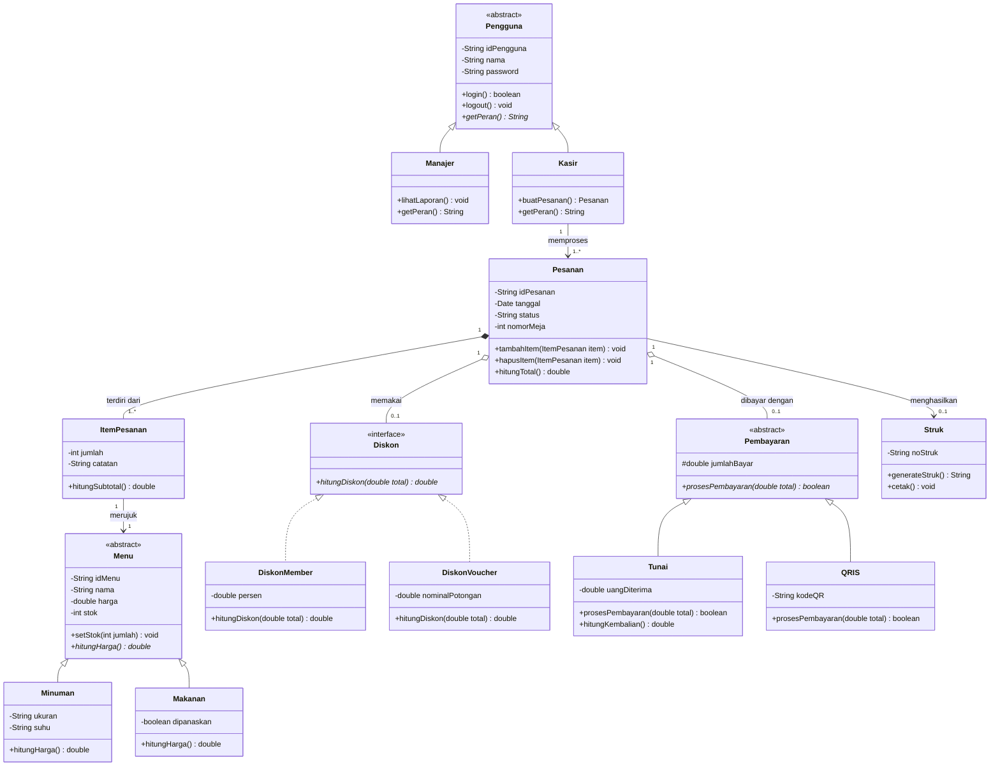

# Dokumentasi Desain: Sistem Pemesanan & Pembayaran Restoran

Dokumen ini menjelaskan rancangan kelas (*class design*), spesifikasi atribut dan metode, hubungan antarentitas (*relationships*), serta pola desain (*design patterns*) yang diterapkan berdasarkan diagram arsitektur.

---

## 1. Class Diagram (UML Representation)

---

## 2. Rincian Spesifikasi Kelas

### 2.1. Paket Pengguna (User Management)
- **`Pengguna` (`«abstract»`)**:
  - Atribut: `- idPengguna: String`, `- nama: String`, `- password: String`
  - Metode: `+ login(): boolean`, `+ logout(): void`, `+ getPeran(): String` (abstrak)
- **`Manajer` (Turunan `Pengguna`)**:
  - Metode: `+ lihatLaporan(): void`, `+ getPeran(): String` (mengembalikan `"Manajer"`)
- **`Kasir` (Turunan `Pengguna`)**:
  - Metode: `+ buatPesanan(): Pesanan`, `+ getPeran(): String` (mengembalikan `"Kasir"`)

### 2.2. Paket Menu (Product Catalog)
- **`Menu` (`«abstract»`)**:
  - Atribut: `- idMenu: String`, `- nama: String`, `- harga: double`, `- stok: int`
  - Metode: `+ setStok(int jumlah): void`, `+ hitungHarga(): double` (abstrak)
- **`Minuman` (Turunan `Menu`)**:
  - Atribut: `- ukuran: String`, `- suhu: String`
  - Metode: `+ hitungHarga(): double` (kalkulasi varian ukuran Regular/Large)
- **`Makanan` (Turunan `Menu`)**:
  - Atribut: `- dipanaskan: boolean`
  - Metode: `+ hitungHarga(): double` (kalkulasi biaya layanan pemanasan)

### 2.3. Paket Transaksi (Order & Line Items)
- **`ItemPesanan`**:
  - Atribut: `- jumlah: int`, `- catatan: String`, `- menu: Menu`
  - Metode: `+ hitungSubtotal(): double` (mengembalikan `jumlah * menu.hitungHarga()`)
- **`Pesanan`**:
  - Atribut: `- idPesanan: String`, `- tanggal: Date`, `- status: String`, `- nomorMeja: int`, relasi ke `items`, `diskon`, `pembayaran`, `struk`
  - Metode: `+ tambahItem(item: ItemPesanan): void`, `+ hapusItem(item: ItemPesanan): void`, `+ hitungTotal(): double`

### 2.4. Paket Diskon (Discount Engine)
- **`Diskon` (`«interface»`)**:
  - Metode: `+ hitungDiskon(double total): double`
- **`DiskonMember` (Implementasi `Diskon`)**:
  - Atribut: `- persen: double`
  - Metode: `+ hitungDiskon(double total): double` (`total * (persen / 100)`)
- **`DiskonVoucher` (Implementasi `Diskon`)**:
  - Atribut: `- nominalPotongan: double`
  - Metode: `+ hitungDiskon(double total): double` (`min(nominalPotongan, total)`)

### 2.5. Paket Pembayaran (Payment Processing)
- **`Pembayaran` (`«abstract»`)**:
  - Atribut: `# jumlahBayar: double` (Protected)
  - Metode: `+ prosesPembayaran(double total): boolean` (abstrak)
- **`Tunai` (Turunan `Pembayaran`)**:
  - Atribut: `- uangDiterima: double`
  - Metode: `+ prosesPembayaran(double total): boolean`, `+ hitungKembalian(): double`
- **`QRIS` (Turunan `Pembayaran`)**:
  - Atribut: `- kodeQR: String`
  - Metode: `+ prosesPembayaran(double total): boolean`

### 2.6. Paket Struk (Receipt Generation)
- **`Struk`**:
  - Atribut: `- noStruk: String`, `- pesanan: Pesanan`
  - Metode: `+ generateStruk(): String`, `+ cetak(): void`

---

## 3. Relasi Antar Kelas & Pola Desain (Design Patterns)

1. **Strategy Pattern pada Diskon**:
   - `Diskon` bertindak sebagai *Strategy Interface*, sedangkan `DiskonMember` dan `DiskonVoucher` sebagai strategi konkret. Kelas `Pesanan` dapat berganti algoritma kalkulasi secara dinamis saat runtime.
2. **Polymorphic Payment Handler**:
   - Abstraksi `Pembayaran` memungkinkan penambahan instrumen pembayaran baru (misal Kartu Kredit atau Dompet Digital) tanpa mengubah logika kelas `Pesanan`.
3. **Template Method & Specialization pada Menu**:
   - Subclass `Makanan` dan `Minuman` mengenkapsulasi aturan penentuan harga varian spesifik masing-masing melalui overriding `hitungHarga()`.

