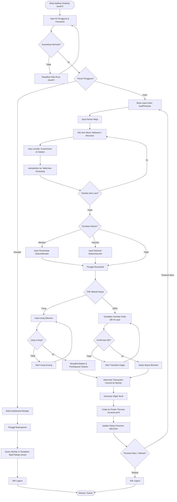
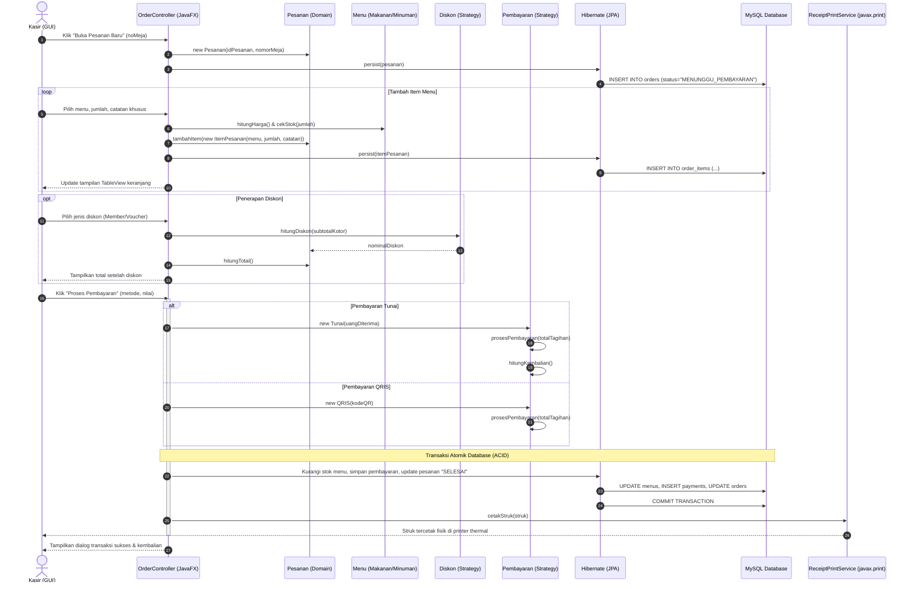

# Product Requirements Document (PRD): Sistem Pemesanan & Pembayaran Restoran

| Informasi Dokumen | Detail |
| :--- | :--- |
| **Nama Produk** | Sistem Kasir Desktop Pemesanan & Pembayaran Restoran |
| **Versi Dokumen** | 3.0.0 |
| **Status** | Approved / Ready for Implementation |
| **Arsitektur Teknis** | **Full Stack Java Desktop Application (JavaFX + Core Java 17+ + Hibernate + MySQL)** |
| **Target Pengguna** | Kasir Restoran, Manajer Operasional, dan Pelanggan Restoran |

---

## 1. Ikhtisar Produk (Product Overview)

### 1.1. Latar Belakang & Masalah
Operasional restoran sering menghadapi hambatan dalam pencatatan pesanan manual yang lambat, kerentanan salah hitung pada kustomisasi varian menu (ukuran minuman, suhu, pemanasan makanan), inkonsistensi kalkulasi diskon voucher dan member, serta keterlambatan dalam pencatatan pembayaran tunai dan verifikasi QRIS. Sistem berbasis desktop kasir (*Point of Sale*) yang tangguh, terintegrasi langsung dengan database relasional MySQL dan printer struk thermal, menjadi kebutuhan vital untuk kelancaran transaksi di meja kasir.

### 1.2. Tujuan Produk (Product Objectives)
- Membangun aplikasi kasir desktop terpadu (**Full Stack Java**) menggunakan **JavaFX GUI** yang modern, responsif, dan mudah dioperasikan.
- Mengimplementasikan seluruh aturan bisnis dan pola perancangan perangkat lunak (*Strategy & Template Method Pattern*) menggunakan **Java SE 17+ (LTS)** berorientasi objek murni.
- Menjamin persistensi data transaksi dan inventori stok menu secara permanen dan aman menggunakan basis data **MySQL 8.0+** melalui **Hibernate ORM / JPA**.
- Mendukung integrasi pencetakan struk transaksi langsung ke perangkat keras printer thermal kasir (*ESC/POS*) via Java Print Service.
- Menyediakan kemudahan instalasi di komputer kasir Windows berupa aplikasi mandiri berkas **`.exe`** (dihasilkan melalui `jpackage`) tanpa ketergantungan instalasi JRE terpisah.

---

## 2. Persona & Peran Pengguna (User Roles)

| Peran (Role) | Perangkat & Antarmuka | Tanggung Jawab Utama | Kebutuhan Sistem |
| :--- | :--- | :--- | :--- |
| **Kasir (`Kasir`)** | Komputer PC Kasir (Aplikasi Desktop JavaFX) | Membuka sesi pesanan meja, memilih item menu & kustomisasi, menerapkan diskon, menerima pembayaran tunai/QRIS, mencetak struk belanja. | Tampilan grid katalog menu cepat, kalkulasi subtotal instan, dialog kembalian tunai, cetak struk thermal sekali klik. |
| **Manajer (`Manajer`)** | Laptop / PC Manajer (Aplikasi Desktop JavaFX) | Memantau seluruh rekapitulasi penjualan harian, memeriksa performa omzet restoran, dan mengevaluasi laporan transaksi. | Antarmuka dashboard pelaporan, tabel riwayat transaksi, filter rentang tanggal, dan rekapitulasi omzet bersih. |
| **Pelanggan** *(Penerima Layanan)* | Meja Restoran / Kasir | Memesan menu makanan/minuman dengan preferensi khusus, memilih metode bayar, menerima struk bukti transaksi. | Transparansi harga, opsi kustomisasi menu, akurasi perhitungan kembalian, dan struk fisik yang rapi. |

---

## 3. Kebutuhan Fungsional (Functional Requirements)

### FR-1: Autentikasi Pengguna & Navigasi Berbasis Peran (RBAC)
- **FR-1.1**: Sistem menyediakan layar login JavaFX yang memvalidasi `idPengguna` dan `password` terhadap basis data MySQL (`Pengguna.login()`).
- **FR-1.2**: Sistem mengarahkan pengguna secara otomatis berdasarkan peran (`getPeran()`):
  - Pengguna dengan peran `Kasir` diarahkan ke layar operasional pemesanan dan kasir meja.
  - Pengguna dengan peran `Manajer` diarahkan ke layar dashboard pelaporan manajerial.
- **FR-1.3**: Pengguna dapat melakukan `logout()` untuk menutup sesi kerja kasir dengan aman.

### FR-2: Manajemen Katalog & Kustomisasi Menu Visual
- **FR-2.1**: Layar kasir menampilkan katalog menu dalam bentuk visual kartu/grid interaktif yang dimuat dari database MySQL.
- **FR-2.2**: Sistem mendukung penanganan varian menu polimorfik:
  - **Makanan**: Menyediakan dialog opsi pemanasan (`dipanaskan: boolean`) yang secara otomatis menghitung biaya kemasan/layanan melalui `hitungHarga()`.
  - **Minuman**: Menyediakan dialog pilihan ukuran (`ukuran`: Regular / Large) dan suhu (`suhu`: Panas / Dingin). Varian Large memicu penyesuaian harga pada `hitungHarga()`.
- **FR-2.3**: Setiap item menu menampilkan sisa `stok`. Sistem memvalidasi ketersediaan stok sebelum item dapat ditambahkan ke pesanan.

### FR-3: Pemrosesan Pesanan (*Order Processing & Cart*)
- **FR-3.1**: Kasir dapat membuka pesanan baru (`buatPesanan()`) dengan memasukkan `nomorMeja` dan ID pesanan unik.
- **FR-3.2**: Kasir dapat menambahkan item menu ke tabel keranjang pesanan (`tambahItem()`) disertai kuantitas (`jumlah`) dan preferensi khusus (`catatan`, misal: "tidak pedas", "sedikit es").
- **FR-3.3**: Subtotal item pesanan dihitung secara otomatis dan real-time:
  $$\text{Subtotal} = \text{jumlah} \times \text{menu.hitungHarga()}$$
- **FR-3.4**: Kasir dapat menghapus item dari keranjang (`hapusItem()`) sebelum pembayaran diselesaikan.

### FR-4: Mesin Promosi & Diskon (*Strategy Pattern*)
- **FR-4.1**: Sistem menyediakan modal penerapan diskon polimorfik melalui implementasi `interface Diskon`:
  - **DiskonMember**: Potongan harga persentase (`persen`) dari total kotor pesanan:
    $$\text{Diskon} = \text{Total Kotor} \times \frac{\text{persen}}{100}$$
  - **DiskonVoucher**: Potongan harga nominal tetap (`nominalPotongan`), dengan proteksi nilai diskon tidak boleh melebihi nilai total kotor:
    $$\text{Diskon} = \min(\text{nominalPotongan}, \text{Total Kotor})$$
- **FR-4.2**: Total akhir tagihan pesanan dihitung oleh kelas `Pesanan.hitungTotal()`:
  $$\text{Total Akhir} = \sum \text{Subtotal Item} - \text{Diskon}$$

### FR-5: Pemrosesan Pembayaran (*Payment Engine*)
- **FR-5.1**: Sistem menyediakan dialog pemilihan metode pelunasan melalui kelas turunan `Pembayaran`:
  - **Tunai**: Kasir menginput `uangDiterima`. Sistem memvalidasi `uangDiterima >= totalTagihan`. Jika valid, sistem menghitung nominal kembalian (`hitungKembalian()`).
  - **QRIS**: Sistem menampilkan grafis kode QR digital transaksi di layar kasir untuk dipindai pelanggan, lalu memvalidasi status penyelesaian transaksi.
- **FR-5.2**: Saat pembayaran berhasil, transaksi disimpan ke database MySQL dan status pesanan diperbarui menjadi `"SELESAI"`.

### FR-6: Penerbitan & Pencetakan Struk Fisik (*Receipt Generation*)
- **FR-6.1**: Sistem secara otomatis menginstansiasi objek `Struk` (`generateStruk()`) saat pembayaran dinyatakan sukses.
- **FR-6.2**: Data struk tersimpan permanen di tabel `receipts` MySQL.
- **FR-6.3**: Modul pencetakan (`ReceiptPrintService`) mengirimkan data teks struk ke printer thermal kasir fisik menggunakan pustaka Java Print Service (`javax.print`) atau antarmuka dialog cetak.

### FR-7: Pelaporan Manajerial & Rekapitulasi Omzet
- **FR-7.1**: Manajer dapat membuka layar laporan (`lihatLaporan()`) yang memuat tabel riwayat transaksi seluruh pesanan berstatus `"SELESAI"`.
- **FR-7.2**: Layar menampilkan ringkasan akumulasi omzet pendapatan kotor, total potongan diskon, omzet pendapatan bersih, dan jumlah transaksi yang berhasil diproses.

---

## 4. Alur Proses Bisnis & Diagram Alir (System Workflows)

### 4.1. Diagram Alir Sistem (System Flowchart)

### 4.2. Sequence Diagram (Interaksi Antar Komponen Desktop & Basis Data)

---

## 5. Kebutuhan Non-Fungsional (Non-Functional Requirements)

| Kategori | Spesifikasi & Kriteria |
| :--- | :--- |
| **Kinerja & Responsivitas** | Antarmuka grafis JavaFX berjalan mulus pada 60 FPS; respon kalkulasi total belanja dan kembalian < 50 ms. |
| **Integritas Data & Transaksi** | Transaksi pembayaran dan pemotongan stok dijamin atomik oleh engine **MySQL InnoDB** melalui transaksi Hibernate JPA. |
| **Keandalan Hardware POS** | Modul pencetakan struk mampu beroperasi secara handal dengan printer kasir antarmuka USB/LAN via standar ESC/POS tanpa memblokir antarmuka utama (*asynchronous printing*). |
| **Kemudahan Distribusi** | Aplikasi dapat dipasang dan dijalankan di komputer kasir Windows sebagai berkas installer mandiri (**`.exe`**) tanpa mewajibkan pengguna menginstal Java JRE terlebih dahulu. |
| **Keterperawatan (Maintainability)** | Kode arsitektur memenuhi prinsip **SOLID** dan pola desain GoF murni (*Strategy Pattern* dan *Template Method Pattern*), terstruktur dalam pola MVC/MVP yang bersih. |

---

## 6. Kriteria Penerimaan (Acceptance Criteria)

- [x] **AC-1**: Pengguna yang memasukkan kredensial tidak valid mendapatkan dialog peringatan visual dan tidak dapat mengakses modul sistem.
- [x] **AC-2**: Kasir tidak dapat menambahkan item menu ke keranjang jika kuantitas melebihi stok yang tercatat pada basis data MySQL.
- [x] **AC-3**: Kustomisasi menu minuman (ukuran *Large*) atau pemanasan makanan secara akurat meningkatkan harga satuan sesuai logika `hitungHarga()`.
- [x] **AC-4**: Diskon voucher nominal divalidasi sehingga tidak mengakibatkan total pembayaran bernilai negatif.
- [x] **AC-5**: Pembayaran tunai dengan nilai uang yang kurang ditolak oleh sistem dan memicu peringatan input uang tidak cukup.
- [x] **AC-6**: Transaksi yang berhasil otomatis memotong stok di MySQL, mencetak struk fisik ke printer kasir, dan mengosongkan keranjang pesanan.
- [x] **AC-7**: Manajer dapat membuka layar laporan untuk meninjau total omzet penjualan bersih dan riwayat seluruh pesanan yang telah berstatus `"SELESAI"`.
